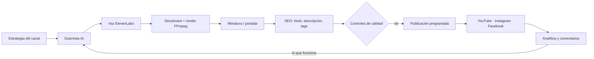

<div align="center">

# 🎬 Oraflow

**Un agente de IA que lleva un canal de YouTube de principio a fin: guion, voz, vídeo, miniatura, publicación y aprendizaje.**

Pensado y probado en producción con un canal real de oraciones en español (vídeos largos + Shorts diarios, YouTube + Instagram + Facebook).

[](LICENSE)
[](package.json)
[](docker-compose.yml)
[](https://keizactech.com/docs)

[Qué hace](#-qué-hace) · [Cómo funciona](#-cómo-funciona) · [Arranque rápido](#-arranque-rápido) · [Claude Code y Codex](#-conectarlo-a-claude-code-o-codex) · [Novedades](#-novedades-y-mejoras) · [Ahorro](AHORRO-Y-MEJORAS.md) · [Docs](https://keizactech.com/docs)

</div>

---

## ✨ Qué hace

Le das un tema y un horario. Oraflow cada día:

1. **Escribe el guion** con IA (OpenRouter, OpenAI, Gemini o un modelo local con Ollama).
2. **Lo narra** con ElevenLabs (voces, velocidad y pausas configurables).
3. **Monta el vídeo**: escenas, fondos de paisaje, música, subtítulos y volumen a -14 LUFS.
4. **Crea la miniatura** (plantillas propias, biblioteca de imágenes o IA).
5. **Optimiza título, descripción y tags** y revisa que no repita títulos.
6. **Publica** en YouTube y, si quieres, en Instagram (Reels, carrusel) y Facebook.
7. **Mide y aprende**: guarda vistas, retención y comentarios, y usa los Shorts que mejor funcionaron como ejemplo para los siguientes.

Todo se controla desde un **panel web en español** y nada se publica sin pasar los controles de calidad.

## 🧠 Cómo funciona



| Pieza | Archivo | Qué hace |
|---|---|---|
| Estrategia | `agents/content-strategy-agent.js` | Elige temas según el nicho y lo que ya funcionó |
| Guion | `agents/script-writer-agent.js` | Escribe el guion (formato largo o Short, con tope de palabras) |
| Producción | `agents/production-management-agent.js` | Voz, escenas y montaje del vídeo |
| Miniaturas | `agents/thumbnail-designer-agent.js` | Plantillas, biblioteca propia o imagen IA |
| SEO | `agents/seo-optimizer-agent.js` | Título, descripción y hashtags |
| Publicación | `agents/publishing-scheduling-agent.js` | Programa y sube, protegiendo la cuota de YouTube |
| Analítica | `agents/analytics-optimization-agent.js` | Mide a 24 h y 7 días y guarda lo aprendido |
| Automatización | `schedules/daily-automation.js` | Las tareas diarias (generar, publicar, medir, limpiar) |
| Panel | `dashboard/` + `index.js` | Panel web y API HTTP |

## 🚀 Arranque rápido

**Necesitas:** Node.js 22 (o Docker), FFmpeg, una clave de IA de texto (OpenRouter es lo más fácil), una clave de ElevenLabs y un proyecto de Google Cloud con YouTube Data API v3.

### Con Docker (recomendado)

```bash
git clone https://github.com/RosaritoRD/oraflow.git
cd oraflow
cp .env.example .env        # abre .env y cambia cada AQUI_VA_... por tu valor
docker compose up -d
```

Abre **http://localhost:3456**, ve a **Conexiones** y conecta tu canal de YouTube.

### Sin Docker

```bash
git clone https://github.com/RosaritoRD/oraflow.git
cd oraflow
npm ci
cp .env.example .env
npm run setup               # asistente de configuración
npm start
```

### Variables importantes

Todas están en [`.env.example`](.env.example), con `AQUI_VA_...` donde va tu dato.

| Variable | Para qué |
|---|---|
| `OPENROUTER_API_KEY` | IA de texto (guiones, títulos, respuestas) |
| `ELEVENLABS_API_KEY` · `ELEVENLABS_VOICE_ID` | Voz de la narración |
| `YOUTUBE_API_KEY` + `config/credentials.json` | Subir vídeos a tu canal (OAuth de Google) |
| `API_KEY` | Clave para usar la API del panel (cabecera `x-api-key`) |
| `CHANNEL_THEME` · `VISUAL_STYLE` · `TARGET_AUDIENCE` | El estilo de tu canal |
| `DAILY_PUBLISH_TIME` · `TZ` | Cuándo publica |
| `LOCAL_LLM_URL` · `LOCAL_LLM_MODEL` | (Opcional) modelo local con Ollama |
| `FFMPEG_REMOTO_URL` | (Opcional) renderizar en otro PC — ver `pc/taller/` |
| `FACEBOOK_PAGE_ID` · `INSTAGRAM_TOKEN` | (Opcional) publicar en Meta |

> 🔒 **Nunca subas tu `.env`, `config/credentials.json` ni `config/tokens.json`.** Ya están en `.gitignore`.

## 🤖 Conectarlo a Claude Code o Codex

Oraflow trae instrucciones para que un asistente de código entienda el proyecto desde el primer minuto: [`CLAUDE.md`](CLAUDE.md) (Claude Code) y [`AGENTS.md`](AGENTS.md) (Codex y otros agentes).

### Claude Code

```bash
npm install -g @anthropic-ai/claude-code
cd oraflow
claude
```

Claude Code lee `CLAUDE.md` solo. Prueba a pedirle:

- *"Explícame cómo se genera un Short, desde el guion hasta la subida."*
- *"Añade un nuevo estilo de miniatura y sus tests."*
- *"Mira los logs de hoy y dime por qué falló la publicación."*

### Codex

```bash
npm install -g @openai/codex
cd oraflow
codex
```

Codex lee `AGENTS.md` solo. Mismos ejemplos que arriba.

### Controlar el canal desde el asistente (API del panel)

Con el panel en marcha, cualquiera de los dos puede usar la API HTTP con tu `API_KEY`:

```bash
# Estado general
curl -s -H "x-api-key: $API_KEY" http://localhost:3456/api/dashboard
# ¿Está todo listo para producir?
curl -s -H "x-api-key: $API_KEY" http://localhost:3456/api/readiness
# Guardar una idea (devuelve su id)…
curl -s -X POST -H "x-api-key: $API_KEY" -H "Content-Type: application/json" \
     -d '{"topic":"Oración para dormir en paz"}' http://localhost:3456/api/ideas
# …y producir el vídeo de esa idea
curl -s -X POST -H "x-api-key: $API_KEY" http://localhost:3456/api/ideas/ID_DE_LA_IDEA/generate
```

> ⚠️ Pon siempre un `API_KEY` largo en tu `.env`: **si lo dejas vacío, la API queda abierta** a cualquiera que llegue al puerto.

Pídele a Claude Code o a Codex: *"Usa la API del panel (está en index.js) para decirme qué vídeos salen mañana."*

> Un servidor MCP nativo está en la lista de ideas: si te interesa, abre un issue.

## 🆕 Novedades y mejoras

Más de 170 cambios para llevarlo a producción con un canal real que publica todos los días:

**Contenido**
- Modo **canal de oraciones**: guiones con reglas de fe, versículos bien citados y cierre configurable.
- **Shorts** de 60–90 s con tope duro de palabras y gancho que nombra la situación del que mira.
- El guionista **aprende de tus Shorts con más vistas** en su primera semana (la forma, no el texto).
- Control de **títulos repetidos** antes de gastar en voz.

**Voz y vídeo**
- **Calendario de voces** (principal, secundaria y voz de mujer en días fijos).
- Pausas, velocidad y estabilidad ajustables; modelo de voz barato opcional para Shorts.
- Volumen normalizado a **-14 LUFS**, movimiento fluido y reintentos si la IA falla.
- **Taller remoto**: el FFmpeg pesado puede correr en tu PC y, si falla, en el servidor (`pc/taller/`).
- **IA local** con Ollama para analizar comentarios, con caída a la nube si el PC no responde.

**Miniaturas y portadas**
- Plantillas de miniatura de oración y **biblioteca de imágenes propias** elegidas por tema.
- La **portada del Short** sube sola como miniatura de YouTube y como portada del Reel.

**Redes y comunidad**
- Publicación en **Instagram** (Reels y carrusel) y **Facebook**.
- **Respuestas automáticas** a comentarios con IA, en contexto del vídeo, con tope diario.
- Mensaje privado opcional a quien comenta «Amén», con lista de no contactar y borrado de datos por petición.

**Operación**
- Panel **en español**, adaptado al móvil, con tarjetas de estado y guías.
- Protección de la **cuota de YouTube** y aviso cuando se agota o caduca un acceso.
- Revisión de **seguridad**: secretos ocultos en el panel, dependencias corregidas.

Historial completo en [CHANGELOG.md](CHANGELOG.md).

## 📚 Documentación

- 💸 **[Ahorro y mejoras](AHORRO-Y-MEJORAS.md)**: cómo gastar menos y qué hace que los vídeos funcionen mejor
- 📖 **Guías completas, tutoriales y más proyectos:** [keizactech.com/docs](https://keizactech.com/docs)
- 🏢 **KEIZAC TECH:** [keizactech.com](https://keizactech.com)
- Guías internas: carpeta [`docs/`](docs/)

## 🤝 Contribuir

1. Haz fork del repo
2. Crea una rama: `git checkout -b mi-mejora`
3. Haz tus cambios **con tests** (`npm test` y `npm run lint` deben pasar)
4. Abre un Pull Request

Reglas cortas en [CONTRIBUTING.md](CONTRIBUTING.md). Preguntas → *Discussions*. Errores → *Issues*.

## 📄 Licencia

MIT — ver [LICENSE](LICENSE).

> Usa esta herramienta para crear contenido legítimo y respeta los [Términos de YouTube](https://www.youtube.com/t/terms).
