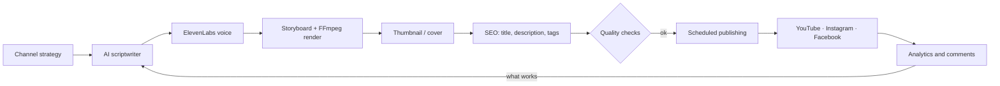

<div align="center">

# 🎬 Oraflow

**An AI agent that runs a YouTube channel end to end: script, voice, video, thumbnail, publishing and learning.**

Designed and battle-tested in production on a real Spanish-language prayer channel (long videos + daily Shorts, YouTube + Instagram + Facebook).

[](LICENSE)
[](package.json)
[](docker-compose.yml)
[](https://keizactech.com/docs)

[What it does](#-what-it-does) · [How it works](#-how-it-works) · [Quick start](#-quick-start) · [Claude Code & Codex](#-connect-it-to-claude-code-or-codex) · [What's new](#-whats-new) · [Savings](SAVINGS-AND-TIPS.md) · [Docs](https://keizactech.com/docs)

</div>

---

## ✨ What it does

Give it a topic and a schedule. Every day, Oraflow:

1. **Writes the script** with AI (OpenRouter, OpenAI, Gemini or a local model with Ollama).
2. **Narrates it** with ElevenLabs (configurable voices, speed and pauses).
3. **Edits the video**: scenes, landscape backgrounds, music, subtitles and loudness at -14 LUFS.
4. **Creates the thumbnail** (its own templates, an image library or AI).
5. **Optimizes title, description and tags**, and checks it isn't repeating titles.
6. **Publishes** to YouTube and, if you want, to Instagram (Reels, carousel) and Facebook.
7. **Measures and learns**: stores views, retention and comments, and uses the best-performing Shorts as examples for the next ones.

Everything is controlled from a **web dashboard** (in Spanish), and nothing gets published without passing the quality checks.

## 🧠 How it works



| Piece | File | What it does |
|---|---|---|
| Strategy | `agents/content-strategy-agent.js` | Picks topics based on the niche and what already worked |
| Script | `agents/script-writer-agent.js` | Writes the script (long-form or Short, with a word cap) |
| Production | `agents/production-management-agent.js` | Voice, scenes and video editing |
| Thumbnails | `agents/thumbnail-designer-agent.js` | Templates, your own library or AI images |
| SEO | `agents/seo-optimizer-agent.js` | Title, description and hashtags |
| Publishing | `agents/publishing-scheduling-agent.js` | Schedules and uploads, protecting your YouTube quota |
| Analytics | `agents/analytics-optimization-agent.js` | Measures at 24 h and 7 days and stores what it learned |
| Automation | `schedules/daily-automation.js` | The daily jobs (generate, publish, measure, clean up) |
| Dashboard | `dashboard/` + `index.js` | Web dashboard and HTTP API |

## 🚀 Quick start

**You need:** Node.js 22 (or Docker), FFmpeg, a text-AI key (OpenRouter is the easiest), an ElevenLabs key and a Google Cloud project with YouTube Data API v3.

### With Docker (recommended)

```bash
git clone https://github.com/RosaritoRD/oraflow.git
cd oraflow
cp .env.example .env        # open .env and replace every YOUR_..._HERE with your value
docker compose up -d
```

Open **http://localhost:3456**, go to **Conexiones** (Connections) and connect your YouTube channel.

### Without Docker

```bash
git clone https://github.com/RosaritoRD/oraflow.git
cd oraflow
npm ci
cp .env.example .env
npm run setup               # setup wizard
npm start
```

### Key variables

They're all in [`.env.example`](.env.example), with `YOUR_..._HERE` wherever your value goes.

| Variable | Purpose |
|---|---|
| `OPENROUTER_API_KEY` | Text AI (scripts, titles, replies) |
| `ELEVENLABS_API_KEY` · `ELEVENLABS_VOICE_ID` | Narration voice |
| `YOUTUBE_API_KEY` + `config/credentials.json` | Upload videos to your channel (Google OAuth) |
| `API_KEY` | Key for the dashboard API (`x-api-key` header) |
| `CHANNEL_THEME` · `VISUAL_STYLE` · `TARGET_AUDIENCE` | Your channel's style |
| `DAILY_PUBLISH_TIME` · `TZ` | When it publishes |
| `LOCAL_LLM_URL` · `LOCAL_LLM_MODEL` | (Optional) local model with Ollama |
| `FFMPEG_REMOTO_URL` | (Optional) render on another PC — see `pc/taller/` |
| `FACEBOOK_PAGE_ID` · `INSTAGRAM_TOKEN` | (Optional) publish to Meta |

> 🔒 **Never commit your `.env`, `config/credentials.json` or `config/tokens.json`.** They're already in `.gitignore`.

## 🤖 Connect it to Claude Code or Codex

Oraflow ships instructions so a coding assistant understands the project from minute one: [`CLAUDE.md`](CLAUDE.md) (Claude Code) and [`AGENTS.md`](AGENTS.md) (Codex and other agents).

### Claude Code

```bash
npm install -g @anthropic-ai/claude-code
cd oraflow
claude
```

Claude Code reads `CLAUDE.md` on its own. Try asking:

- *"Explain how a Short is made, from script to upload."*
- *"Add a new thumbnail style with its tests."*
- *"Look at today's logs and tell me why publishing failed."*

### Codex

```bash
npm install -g @openai/codex
cd oraflow
codex
```

Codex reads `AGENTS.md` on its own. Same examples as above.

### Control the channel from the assistant (dashboard API)

With the dashboard running, either assistant can use the HTTP API with your `API_KEY`:

```bash
# Overall status
curl -s -H "x-api-key: $API_KEY" http://localhost:3456/api/dashboard
# Is everything ready to produce?
curl -s -H "x-api-key: $API_KEY" http://localhost:3456/api/readiness
# Save an idea (returns its id)…
curl -s -X POST -H "x-api-key: $API_KEY" -H "Content-Type: application/json" \
     -d '{"topic":"Prayer to sleep in peace"}' http://localhost:3456/api/ideas
# …and produce the video for that idea
curl -s -X POST -H "x-api-key: $API_KEY" http://localhost:3456/api/ideas/IDEA_ID/generate
```

> ⚠️ Always set a long `API_KEY` in your `.env`: **if you leave it empty, the API is open** to anyone who can reach the port.

Ask Claude Code or Codex: *"Use the dashboard API (it's in index.js) to tell me which videos go out tomorrow."*

> A native MCP server is on the ideas list — if you're interested, open an issue.

## 🆕 What's new

More than 170 changes to take it to production with a real channel that publishes every day:

**Content**
- **Prayer channel** mode: scripts with faith rules, correctly quoted verses and a configurable closing.
- 60–90 s **Shorts** with a hard word cap and a hook that names the viewer's situation.
- The scriptwriter **learns from your most-viewed Shorts** in their first week (the shape, not the text).
- **Duplicate-title** check before spending on voice.

**Voice and video**
- **Voice calendar** (main, secondary and a female voice on fixed days).
- Adjustable pauses, speed and stability; optional cheaper voice model for Shorts.
- Loudness normalized to **-14 LUFS**, smooth motion and retries when the AI fails.
- **Remote workshop**: heavy FFmpeg work can run on your PC and fall back to the server (`pc/taller/`).
- **Local AI** with Ollama to analyze comments, falling back to the cloud if the PC doesn't answer.

**Thumbnails and covers**
- Prayer thumbnail templates and a **library of your own images** picked by topic.
- The **Short's cover** is uploaded automatically as the YouTube thumbnail and the Reel cover.

**Social and community**
- Publishing to **Instagram** (Reels and carousel) and **Facebook**.
- AI **auto-replies** to comments, in the context of the video, with a daily cap.
- Optional private message to whoever comments «Amén», with a do-not-contact list and data deletion on request.

**Operations**
- Mobile-friendly **Spanish-language dashboard** with status cards and guides.
- **YouTube quota** protection and alerts when it runs out or an access token expires.
- **Security** review: secrets hidden in the dashboard, dependencies patched.

Full history in [CHANGELOG.md](CHANGELOG.md).

## 📚 Documentation

- 💸 **[Savings and tips](SAVINGS-AND-TIPS.md)**: how to spend less and what makes videos perform better
- 📖 **Full guides, tutorials and more projects:** [keizactech.com/docs](https://keizactech.com/docs)
- 🏢 **KEIZAC TECH:** [keizactech.com](https://keizactech.com)
- Internal guides: the [`docs/`](docs/) folder

## 🤝 Contributing

1. Fork the repo
2. Create a branch: `git checkout -b my-improvement`
3. Make your changes **with tests** (`npm test` and `npm run lint` must pass)
4. Open a Pull Request

Short rules in [CONTRIBUTING.md](CONTRIBUTING.md). New here? Look for the [`good first issue`](https://github.com/RosaritoRD/oraflow/labels/good%20first%20issue) label. Questions → [Discussions](https://github.com/RosaritoRD/oraflow/discussions). Bugs → [Issues](https://github.com/RosaritoRD/oraflow/issues).

## 📄 License

MIT — see [LICENSE](LICENSE).

> Use this tool to create legitimate content and respect [YouTube's Terms of Service](https://www.youtube.com/t/terms).
